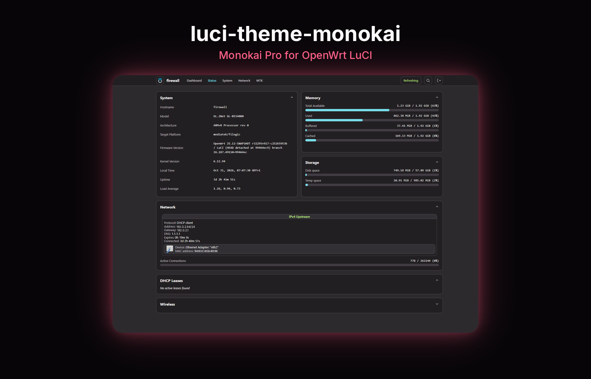

# REFFIX Monokai Pro for LuCI

Monokai Pro for OpenWrt LuCI. Pairs with [REFFIX Log Viewer](https://github.com/REFFIX-X/luci-app-log).

**[v2.1.0](https://github.com/REFFIX-X/luci-theme-monokai/releases/tag/v2.1.0)** · OpenWrt 25.12/APK

Light and dark Monokai Pro, a command palette (`Ctrl+K`), and in-place navigation that asks before leaving unsaved edits. [Benchmark](docs/benchmark.md).

## Install

OpenWrt 25.12/APK, or a MediaTek Filogic snapshot. Over SSH as root:

```sh
uclient-fetch -qO- https://raw.githubusercontent.com/REFFIX-X/luci-theme-monokai/main/install-online.sh | sh
```

The script checks the APK's SHA-256, then installs `luci-theme-footstrap`. Run it again to replace an older copy. The same version stays. An existing Design is not changed.

Then open **System → System → Language and Style** and choose **Monokai Pro**. That happens only when no Design is set. Hard-refresh with **Ctrl+F5** if the old stylesheet remains.

<details>
<summary>Install by hand</summary>

From the [v2.1.0 release](https://github.com/REFFIX-X/luci-theme-monokai/releases/tag/v2.1.0), download `reffix-luci-theme-footstrap-openwrt-25.12.apk` and `SHA256SUMS-openwrt-25.12.txt`. Optional language packages: `luci-i18n-footstrap-es-0.apk`, `luci-i18n-footstrap-ru-0.apk`.

```sh
cd /tmp
sha256sum reffix-luci-theme-footstrap-openwrt-25.12.apk
grep reffix-luci-theme-footstrap-openwrt-25.12.apk SHA256SUMS-openwrt-25.12.txt
apk add --repositories-file /dev/null --allow-untrusted --upgrade /tmp/reffix-luci-theme-footstrap-openwrt-25.12.apk
```

The two hashes must match. A language package uses the same check and the same `apk add` line.

</details>

## Credits

Colour and branding adaptation of [VizzleTF/luci-theme-footstrap](https://github.com/VizzleTF/luci-theme-footstrap). Apache-2.0 where the source project says so.
